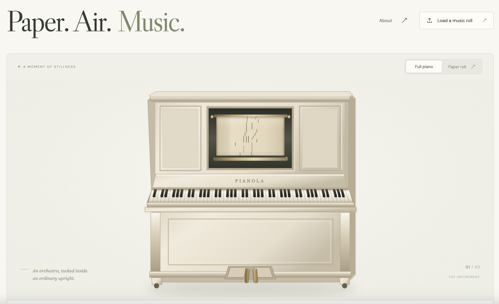
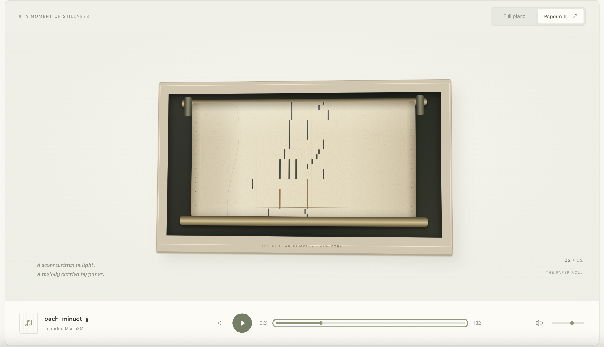

# 纸上音符 · Paper Notes

[中文](README.md) | [English](README.en.md)

A vintage player-piano web app with a warm-white interface, an ivory upright piano, and brass mechanical details. Import a MIDI or MusicXML score to watch a perforated paper roll move downward in sync with the music and piano keys.

[Try the app](https://pianola-paper-and-sound.huangyixiu1.chatgpt.site/)

## Preview



Full-piano view: the complete instrument, including its 88-key keyboard, paper-roll mechanism, and pedals.



In the paper-roll view, horizontal position represents pitch and perforation length represents note duration. During playback, the paper moves downward and notes sound as they cross the tracker line.

## Sheet-music learning mode

Use the **打孔卷轴 / 五线谱** (paper roll / sheet music) switch above the instrument to open the printed score. [OpenSheetMusicDisplay](https://github.com/opensheetmusicdisplay/opensheetmusicdisplay) engraves the original MusicXML, preserving grand staves, accidentals, chords, slurs, repeats, and written fingerings.

- **Follow the current column:** a vertical highlight spans both staves and follows playback, repeats, tempo changes, and seeking, with automatic scrolling.
- **Connect notes to keys:** the learning keyboard and original piano keys highlight together. Green identifies the lower/left-hand staff and gold the upper/right-hand staff. Pause to inspect pitches, keys, and written fingerings, or click a key to hear it.
- **Practice slowly:** playback speed goes down to 25%. Toggle **自动跟随** (follow) to **自由浏览** (free browsing) to inspect a passage without automatic scrolling.
- **Read original fingerings:** when MusicXML includes finger numbers, the score, note readouts, and keyboard show them (1–5). Scores without fingerings show key positions only. Hands are grouped by staff and clef; cross-hand techniques are not inferred.

MIDI contains neither original notation spelling nor fingering. Its generated notation is quantized to sixteenth notes, with hands estimated by a middle-C pitch split, while original audio timing remains unchanged. For complex rhythms, voices, and fingering study, use MusicXML to retain the written score.

## Features

- **Two interface languages:** Chinese by default, with a 中文 / EN switch. BPM, MIDI, and MusicXML retain their standard names. Interface text ranges from 13 to 38px, with the title capped at 38px.

- **Two cameras:** full piano and paper-roll close-up, with smooth transitions.
- **Vintage visuals:** a 2.5D upright piano, textured and aged paper, brass spools, and a complete 88-key keyboard.
- **Built-in score:** the full Für Elise MusicXML score, parsed by the same importer used for uploaded files.
- **Score import:** MIDI (`.mid`, `.midi`), MusicXML (`.xml`, `.musicxml`), and compressed MusicXML (`.mxl`), through file selection or drag and drop.
- **Synchronized performance:** paper movement, synthesized sound, and key highlights share one timeline.
- **Sheet-music display:** an on-demand engraving engine, synchronized columns, automatic following, original fingerings, and an interactive learning keyboard.
- **Playback controls:** play, pause, seek, rewind, speed, volume, and mute. Space toggles playback.
- **Local processing:** scores are parsed in the browser without uploading them to a server.
- **Responsive interaction:** responsive layout, keyboard controls, and support for reduced-motion preferences.

## Run locally

Requires Node.js and npm. From the repository root:

```sh
npm ci
npm run dev
```

Open the local URL printed in your terminal.

## Build and deploy

```sh
npm run build
```

The build output is written to `dist/` and can be deployed to a static hosting service. `.openai/hosting.json` retains this project's existing Sites deployment configuration.

## Score parsing and playback scope

MIDI preserves note timing, velocity, and tempo changes, excluding percussion tracks. MusicXML supports divisions, rests, chords, multiple voices, backup/forward timing, tempo changes, transposition, ties, repeats, and alternate endings.

Current limitations:

- Audio uses a local piano-like synthesizer rather than acoustic piano samples or a physical pneumatic model.
- MusicXML must use the `score-partwise` format.
- Grace notes, expressive ornaments, D.C./D.S./coda navigation, and pedal markings are not interpreted.
- Only notes within the 88-key range A0–C8 are played.
- Playback pauses when the browser tab is hidden.

## Verification

`qa/browser-check.js` provides a browser verification function covering the default score, 88-key layout, MIDI tempo changes, MusicXML polyphony and ties, repeats and alternate endings, compressed MusicXML, invalid files, file import, and playback controls. Run it through browser script evaluation against the development server.

`qa/sheet-check.js` verifies score engraving, source repeats, tempo changes, grand-staff cursor positions, paused key highlights, original fingerings, MIDI transcription, and mode switching.
